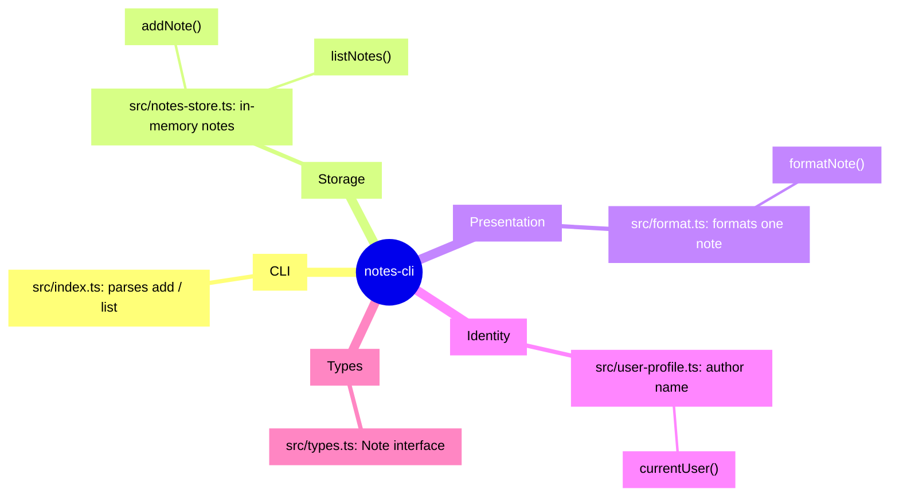

<!-- codemap: generated file — hand edits outside a manual-edit block are replaced by /codemap refresh -->

# Mindmap

The `notes-cli` project at a glance, grouped by what each file does.

Five groups, one per responsibility, each holding a single source file.

## Groups

- **CLI** — command-line entry that reads `add` or `list` and prints usage on anything else.
- **Storage** — keeps notes in a module-level array, so they last only for one process run.
- **Presentation** — turns a note into a line like `#1 text (author)`.
- **Identity** — returns the `USER` environment variable, or `anonymous`.
- **Types** — the shared `Note` shape (`id`, `text`, `author`).

Left out: `package.json`, `README.md` and `tsconfig.json` (project metadata, no logic).

## Not covered

The small repo was read completely except `tsconfig.json`, which was not opened.
