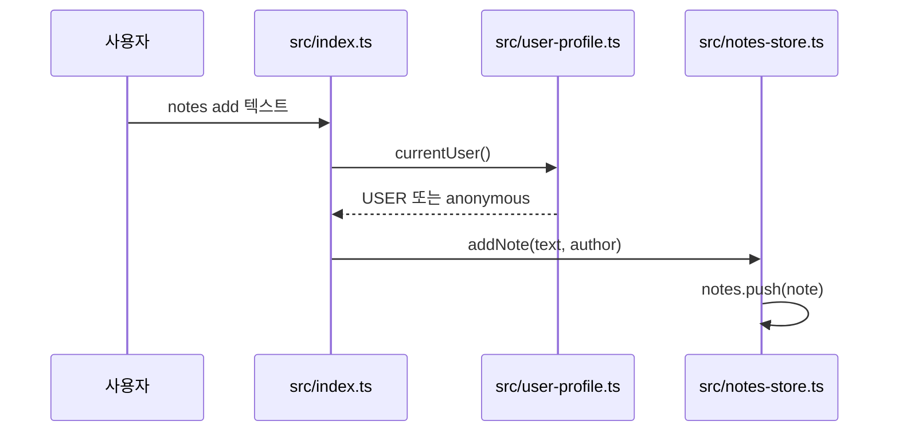
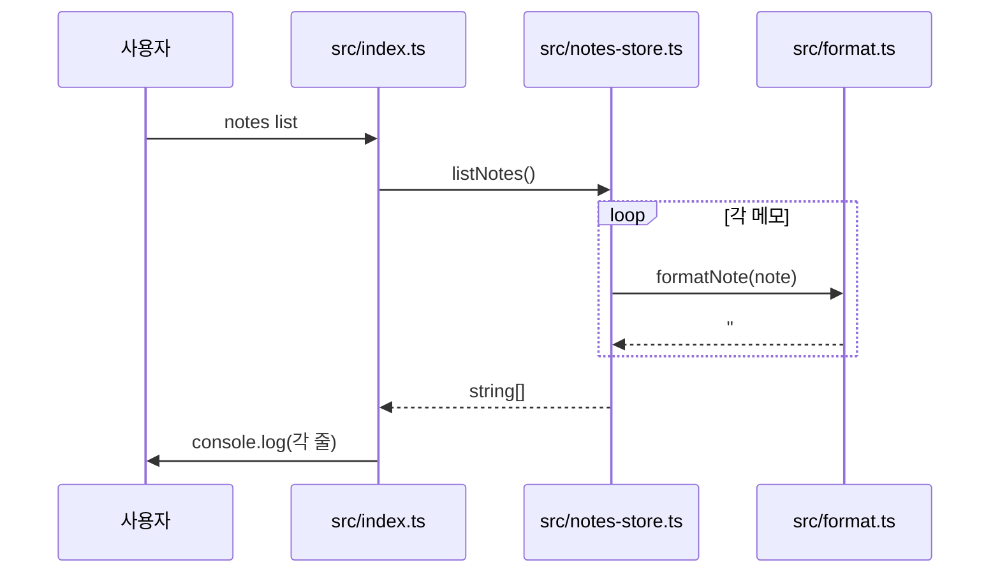
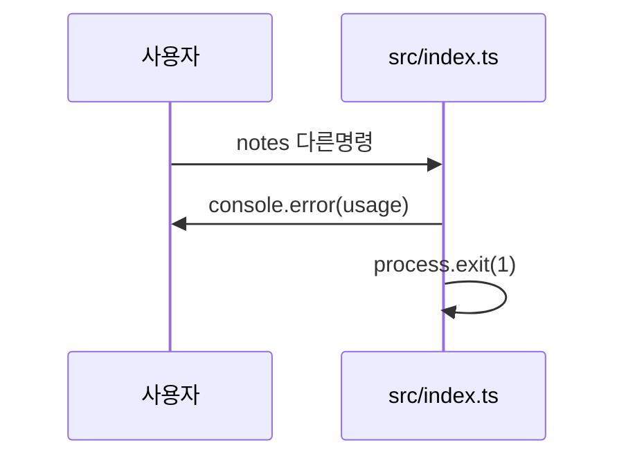

<!-- codemap: generated file — hand edits outside a manual-edit block are replaced by /codemap refresh -->

# 시퀀스 흐름

명령줄에서 실행했을 때 코드가 실제로 어떤 순서로 호출되는지 세 가지 시나리오로 따라가 본 기록입니다. 시나리오는 가장 핵심인 `add`, 저장소를 거치는 `list`, 그리고 코드에 있는 오류 경로(알 수 없는 명령) 순으로 골랐습니다.

## notes add 실행

사용자가 `notes add <text>`를 실행하면 시작됩니다.

1. 인자를 `[command, ...rest]`로 나누고 `command === "add"`를 확인합니다 — `src/index.ts:top-level`
2. 작성자를 얻습니다 — `src/user-profile.ts:currentUser`
3. 나머지 인자를 공백으로 이어 붙여 메모를 저장합니다 — `src/notes-store.ts:addNote`

## notes list 실행

사용자가 `notes list`를 실행하면 시작됩니다.

1. `command === "list"` 분기로 들어갑니다 — `src/index.ts:top-level`
2. 모든 메모를 `map(formatNote)`로 변환합니다 — `src/notes-store.ts:listNotes`
3. 한 줄 문자열을 만듭니다 — `src/format.ts:formatNote`
4. 각 줄을 출력합니다 — `src/index.ts:top-level`

## 알 수 없는 명령 (오류 경로)

사용자가 `add`, `list`가 아닌 명령을 주면 시작됩니다.

1. 두 분기에 모두 맞지 않으면 `else`로 갑니다 — `src/index.ts:top-level`
2. 사용법을 표준 오류로 찍고 종료 코드 1로 끝냅니다 — `src/index.ts:top-level`

## 다루지 않은 범위

`src/types.ts`는 타입 선언뿐이라 호출 흐름에 나오지 않습니다. `tsconfig.json`과 `dist/`는 읽지 않았고, 추적하지 못한 호출은 없습니다.
