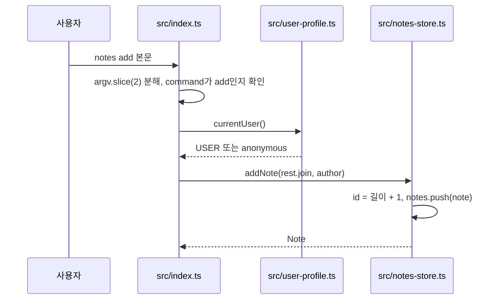
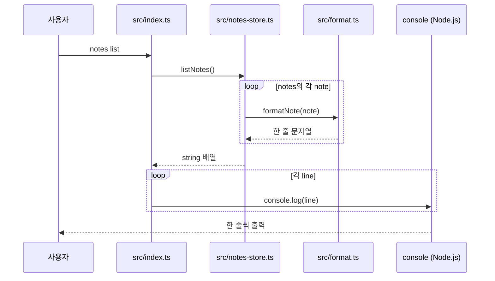
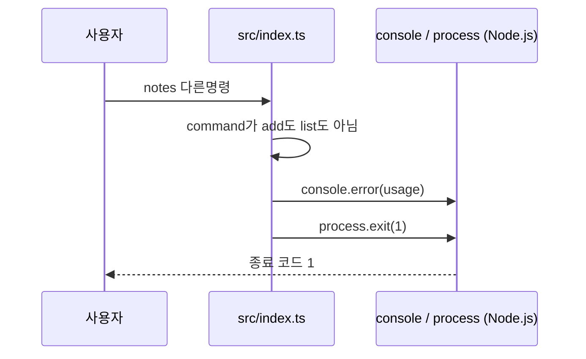

<!-- codemap: generated file — hand edits outside a manual-edit block are replaced by /codemap refresh -->

# 시퀀스 흐름

명령줄 진입점에서 시작해 실제 함수 호출을 따라간 세 가지 실행 시나리오입니다: 가장 핵심인 `add`, 조회하는 `list`, 오류 경로인 알 수 없는 명령.

## 메모 추가: notes add

사용자가 `notes add "text"`를 실행하면 `src/index.ts`가 인자를 해석해 메모를 저장합니다.

저장은 메모리 배열에만 일어나며, `add` 분기는 반환된 `Note`를 쓰지 않고 아무것도 출력하지 않습니다.

1. 인자 분해와 `add` 분기: `src/index.ts`(최상위 코드, `process.argv.slice(2)`)
2. 작성자 조회: `src/user-profile.ts:currentUser`
3. 메모 생성과 저장: `src/notes-store.ts:addNote`
4. 반환된 `Note`는 호출부가 버립니다: `src/index.ts`

## 메모 조회: notes list

사용자가 `notes list`를 실행하면 저장소가 메모를 한 줄씩 포맷해 돌려주고 진입점이 출력합니다.

`notes`는 프로세스 시작 때 빈 배열이므로, 같은 프로세스 안에서 `add`를 하지 않은 새 `notes list` 실행은 아무것도 출력하지 않습니다.

1. `list` 분기: `src/index.ts`(최상위 코드)
2. 목록 생성: `src/notes-store.ts:listNotes` (`notes.map(formatNote)`)
3. 한 줄 포맷: `src/format.ts:formatNote`
4. 줄별 출력: `src/index.ts`(`forEach` 안의 `console.log`)

## 오류 경로: 알 수 없는 명령

`add`도 `list`도 아닌 명령이 들어오면 사용법을 출력하고 종료 코드 1로 끝납니다.

이 경로는 저장소와 포맷터를 전혀 거치지 않고 `src/index.ts` 안에서 끝납니다.

1. 분기 판단: `src/index.ts`(`else` 분기)
2. 사용법 출력: `src/index.ts`(`console.error`)
3. 종료: `src/index.ts`(`process.exit(1)`)

## 다루지 않은 범위

`src/`의 5개 파일을 모두 읽었고 따라가지 못한 호출은 없습니다. `console`과 `process`는 Node.js 내장 객체라 내부 동작은 추적하지 않았습니다. 인자 없이 `notes`만 실행하는 경우도 `command`가 `undefined`라서 위 오류 경로와 같게 동작합니다.
