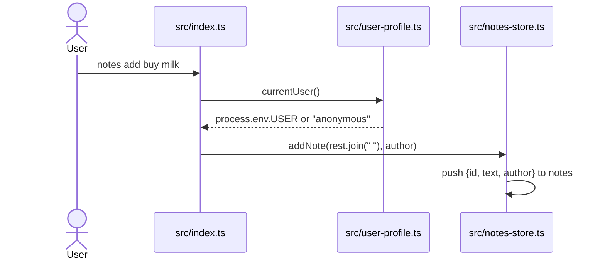
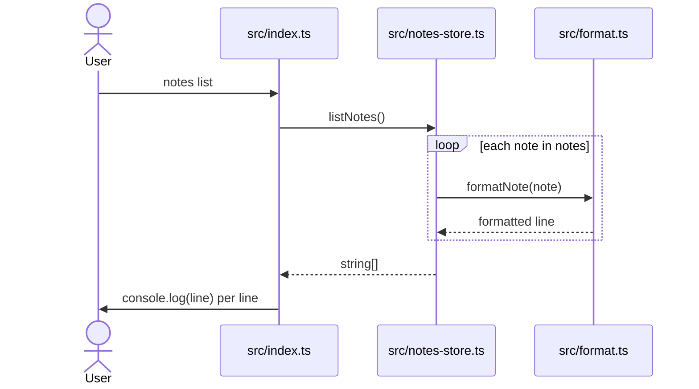
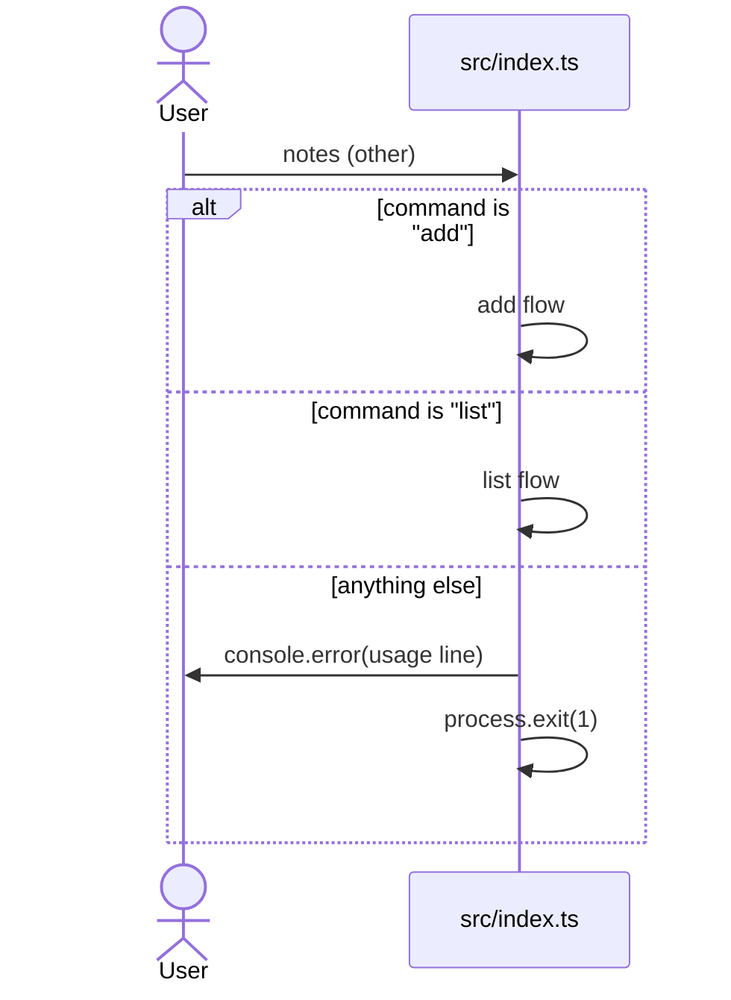

<!-- codemap: generated file — hand edits outside a manual-edit block are replaced by /codemap refresh -->

# Sequence flows

Three runtime scenarios of the CLI, traced through `src/index.ts` and the modules it calls: `add` (the main operation), `list` (reads storage), and an unknown command (the error path).

## Scenario 1: `notes add <text>`

The user runs `notes add "buy milk"`.

1. `src/index.ts:top level` — takes `command` and `rest` from `process.argv.slice(2)`; `command === "add"`.
2. `src/user-profile.ts:currentUser` — returns `process.env.USER ?? "anonymous"`.
3. `src/notes-store.ts:addNote` — creates a note with `id = notes.length + 1` and pushes it; the returned note is ignored by the caller and nothing is printed.

## Scenario 2: `notes list`

The user runs `notes list`.

1. `src/index.ts:top level` — `command === "list"`.
2. `src/notes-store.ts:listNotes` — maps every stored note through `formatNote`.
3. `src/format.ts:formatNote` — returns `` `#${note.id} ${note.text} (${note.author})` ``.
4. `src/index.ts:top level` — prints each returned line with `console.log`.

Because the array lives only in the running process, a fresh `notes list` invocation starts with an empty array and prints nothing.

## Scenario 3: unknown or missing command

The user runs `notes` with no arguments or an unsupported word.

1. `src/index.ts:top level` — neither branch matches, so the final `else` prints the usage line to stderr and exits with code 1.

## Not covered

All source files on these paths were read completely. `src/types.ts` only contributes the `Note` type and is not a participant. Build output (`dist/`) and Node internals were not examined.
