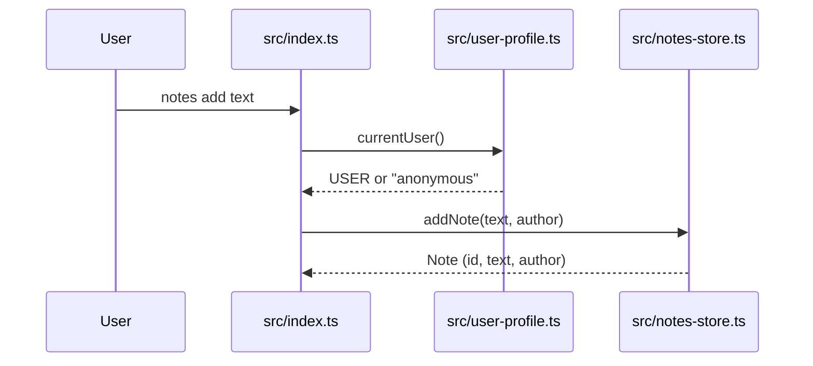
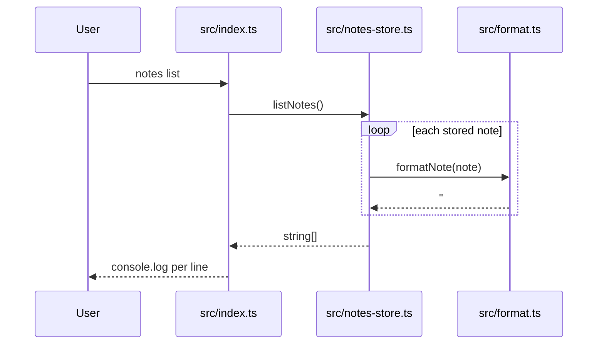
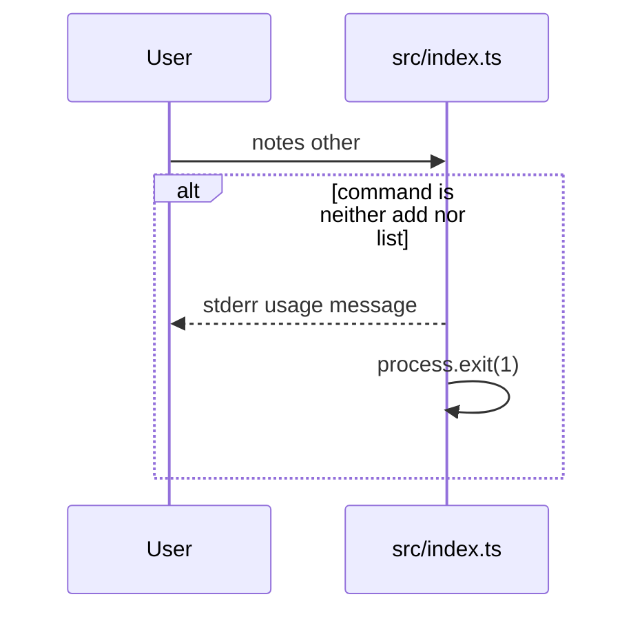

<!-- codemap: generated file — hand edits outside a manual-edit block are replaced by /codemap refresh -->

# Sequence flows

Three runtime scenarios traced from `src/index.ts`: the `add` command, the `list` command, and the unknown-command error path.

## The add command

The user runs `notes add <text>`.

The process then ends silently: `src/index.ts` ignores the returned note and prints nothing.

1. `src/index.ts` splits `process.argv` into `command` and `rest` and joins `rest` into the note text.
2. `src/user-profile.ts:currentUser` returns `process.env.USER ?? "anonymous"`.
3. `src/notes-store.ts:addNote` builds `{ id: notes.length + 1, text, author }` and pushes it onto the module-level array.

## The list command

The user runs `notes list`.

Because the array is created fresh in each process, a separate `notes list` run prints nothing.

1. `src/index.ts` matches `command === "list"`.
2. `src/notes-store.ts:listNotes` maps the array through `formatNote`.
3. `src/format.ts:formatNote` returns `` `#${note.id} ${note.text} (${note.author})` ``.
4. `src/index.ts` prints each line with `console.log`.

## Unknown command

The user runs `notes` with no command or an unrecognised one.

The program writes the usage line to standard error and exits with code 1.

1. `src/index.ts` falls through to the final `else` branch.
2. It calls `console.error("usage: notes add <text> | notes list")` and then `process.exit(1)`.

## Not covered

The small repo was read completely except `tsconfig.json` and `src/types.ts` (a type-only interface with no runtime calls). No call in these flows was untraced.
