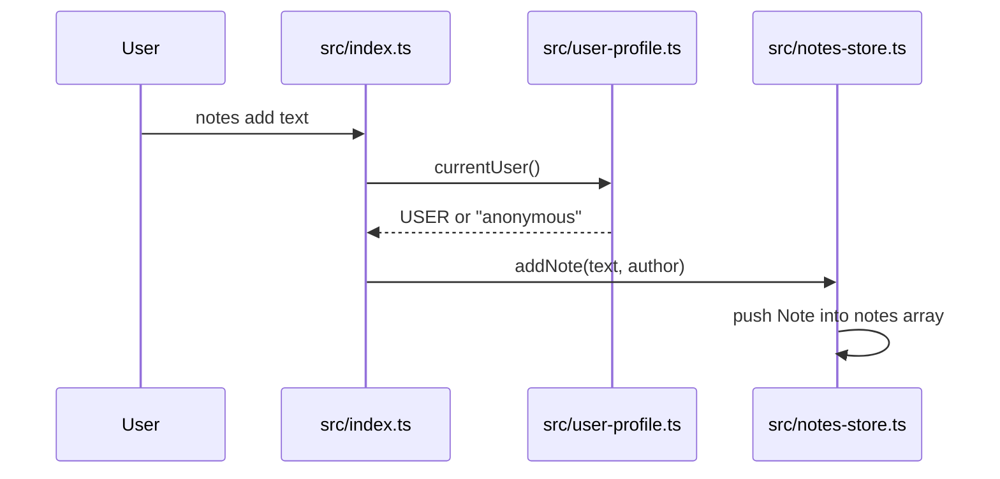
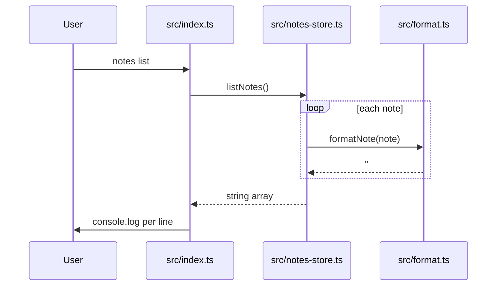
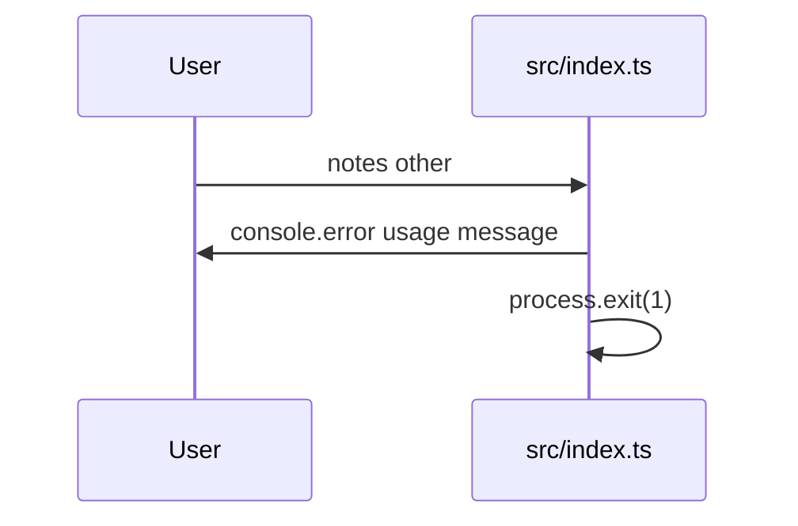

<!-- codemap: generated file — hand edits outside a manual-edit block are replaced by /codemap refresh -->

# Sequence flows

Three scenarios traced through the code: `notes add`, `notes list`, and an unknown command. They were chosen as the write path, the read path and the only error path in `src/index.ts`.

## notes add

Trigger: the user runs `notes add <text>`.

The text is the remaining arguments joined by spaces, and the new note is appended to the in-memory array.

1. `src/index.ts:top level` reads `process.argv`, matches `command === "add"`, and joins the remaining args.
2. `src/user-profile.ts:currentUser` returns `process.env.USER ?? "anonymous"`.
3. `src/notes-store.ts:addNote` builds `{ id, text, author }` with `id = notes.length + 1` and pushes it.

Nothing is printed on success, because `src/index.ts` ignores the returned `Note`.

## notes list

Trigger: the user runs `notes list`.

Each stored note is formatted into one line and printed.

1. `src/index.ts:top level` matches `command === "list"`.
2. `src/notes-store.ts:listNotes` maps `formatNote` over the notes array.
3. `src/format.ts:formatNote` returns `#${id} ${text} (${author})`.
4. `src/index.ts:top level` prints each line with `console.log`.

Because the array is in memory only, a fresh process always lists nothing.

## Unknown command

Trigger: the user runs `notes` with no command or an unknown one.

The usage line goes to stderr and the process exits with code 1.

1. `src/index.ts:top level` falls through to the `else` branch, prints `usage: notes add <text> | notes list`, and exits with status 1.

## Not covered

Nothing was skipped; all source files on these paths were read. Node's own `process` and `console` internals are library boundaries and were not traced.
